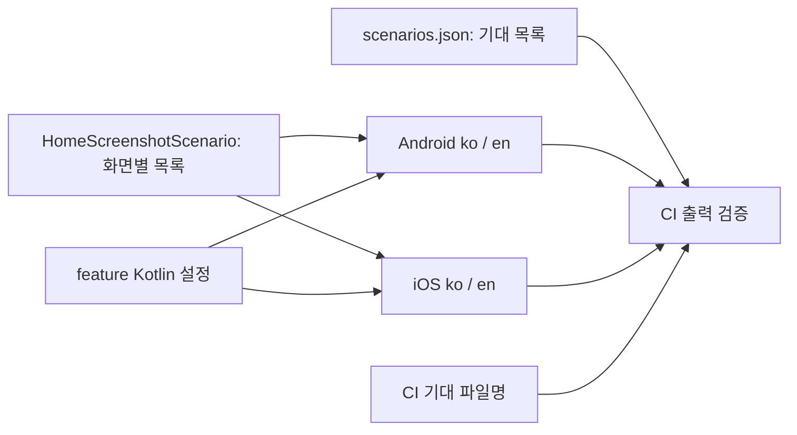

# Home 스크린샷 작성 예제

시나리오를 처음 만들거나 화면별 목록·플랫폼 실행을 바꿀 때 읽는다. 명령은 저장소 루트에서 실행한다.
사용자가 캡처 실행을 중지했다면 아래 record/compare 명령은 실행하지 않는다.

## 실제 화면·상태

```kotlin
internal fun HomeScreen(state: HomeState, onIntent: (HomeIntent) -> Unit)

data class HomeState(
    val nickname: String = "",
    val streakState: HomeStreakState = HomeStreakState.Loading,
    val decks: ImmutableList<Deck> = persistentListOf(),
    val isLoading: Boolean = true,
    val hasLoadError: Boolean = false,
)

data class Deck(
    val id: Long,
    val title: String,
    val description: String,
    val cardTotalCount: Int,
    val todayLearningCount: Int,
    val todayCompleteCount: Int,
    val state: DeckState,
)
```

`isLoadedContentVisible`, `isDeckEmpty`는 HomeState의 파생 값이다. 화면 상태를 렌더링할 때 isLoading을 명시한다.
모델과 Screen의 현재 선언을 확인한 뒤 예제를 적용한다.

## 기대 목록과 실행 코드

`scripts/screenshot/scenarios.json`에 등록한다.

```json
{"home": ["home.home.with_deck"]}
```

CI는 JSON의 ID를 언어·프로필로 확장해 실제 출력과 대조한다. JSON은 코드를 생성하거나 테스트를 실행하지 않는다.
화면별 `***ScreenshotScenario.scenarios()`를 해당 Android/iOS 래퍼가 직접 전달한다.



## 고정 렌더러와 공유 의미 단언

[HomeScreenshotScenario.kt](../../../../feature/home/src/commonTest/kotlin/com/whatever/caro/feature/home/HomeScreenshotScenario.kt):

```kotlin
package com.whatever.caro.feature.home

import androidx.compose.runtime.Composable
import androidx.compose.ui.test.assertIsDisplayed
import androidx.compose.ui.test.onNodeWithText
import com.whatever.caro.core.designsystem.themes.CaroTheme
import com.whatever.caro.core.model.deck.Deck
import com.whatever.caro.core.model.deck.DeckState
import com.whatever.caro.feature.home.mvi.HomeState
import com.whatever.caro.feature.home.mvi.HomeStreakState

import kotlinx.collections.immutable.persistentListOf

internal object HomeScreenshotScenario {
    const val ID = "home.home.with_deck"

    fun scenarios() =
        listOf(
            ScreenshotScenario(
                ID,
                render = { Render() },
                beforeCapture = { language ->
                    onNodeWithText(if (language == "ko") "덱 만들기" else "Create Deck").assertIsDisplayed()
                },
            ),
        )

    @Composable
    fun Render() {
        CaroTheme {
            HomeScreen(
                state =
                    HomeState(
                        nickname = "승우",
                        streakState = HomeStreakState.NotStarted,
                        decks = persistentListOf(Deck(1, "Android", "기초 학습", 10, 5, 0, DeckState.NOT_STARTED)),
                        isLoading = false,
                    ),
                onIntent = {
                },
            )
        }
    }
}
```

`ScreenshotCapture.kt`에는 feature-local Kotlin 설정·case 모델·확장·캔버스·기하 보조 코드를 둔다. 화면의 목록은 `HomeScreenshotScenario.kt`에 둔다.

```kotlin
internal data class ScreenshotProfile(
    val platform: String, val variant: String, val id: String,
    val widthPx: Int, val heightPx: Int, val density: Float, val fontScale: Float,
)

internal object ScreenshotConfiguration {
    val languages = listOf("ko", "en")
    val profiles = listOf(
        ScreenshotProfile("android", "default", "pixel10-pro", 1280, 2856, 3f, 1f),
        ScreenshotProfile("android", "narrow", "pixel10-pro-narrow", 960, 2100, 3f, 1f),
        ScreenshotProfile("android", "small-large-font", "pixel10-pro-small-large-font", 960, 1440, 3f, 1.5f),
        ScreenshotProfile("ios", "default", "iphone18-pro", 1206, 2622, 3f, 1f),
        ScreenshotProfile("ios", "narrow", "iphone18-pro-narrow", 960, 2100, 3f, 1f),
        ScreenshotProfile("ios", "small-large-font", "iphone18-pro-small-large-font", 960, 1440, 3f, 1.5f),
    )
    val variants = mapOf(
        "setting.notification.small.large-font" to "small-large-font",
        LibraryScreenshotScenario.NARROW_ID to "narrow",
        LibraryScreenshotScenario.ENGLISH_NARROW_ID to "narrow",
        LibraryScreenshotScenario.ENGLISH_ERROR_ID to "narrow",
    )
    val contentSizedScenarios = setOf("setting.notification.permission", LibraryScreenshotScenario.ENGLISH_ERROR_ID)
}

internal class ScreenshotScenario(
    val id: String,
    val render: @Composable () -> Unit,
    val isDialog: Boolean = false,
    val beforeCapture: SemanticsNodeInteractionsProvider.(String) -> Unit = {},
    val afterCapture: SemanticsNodeInteractionsProvider.(String) -> Unit = {},
)

internal data class ScreenshotCapture(
    val scenario: ScreenshotScenario,
    val language: String,
    val profile: ScreenshotProfile,
) {
    var renderedDensity: Density? = null
    val fileName = "${scenario.id}__${language}__${profile.id}.png"
    override fun toString(): String = fileName
}

internal fun screenshotCaptures(
    platform: String,
    scenarios: () -> List<ScreenshotScenario>,
): List<ScreenshotCapture> = ScreenshotConfiguration.languages.flatMap { language ->
    val fresh = scenarios()
    require(fresh.map { it.id }.distinct().size == fresh.size)
    fresh.map { scenario ->
        val variant = ScreenshotConfiguration.variants[scenario.id] ?: "default"
        val profile = ScreenshotConfiguration.profiles.single { it.platform == platform && it.variant == variant }
        ScreenshotCapture(scenario, language, profile)
    }
}
```

`ScreenshotConfiguration`와 `ScreenshotProfile`은 해당 feature에 직접 선언한다. `caro.screenshot`은 Roborazzi·테스트 의존성만 연결한다.
언어·프로필 ID를 바꾸면 세 워크플로의 Bash·jq 기대 파일명 규칙도 함께 수정한다. 이 규칙은 테스트 설정을 생성하지 않는다.
[Home의 캡처 보조 코드](../../../../feature/home/src/commonTest/kotlin/com/whatever/caro/feature/home/ScreenshotCapture.kt)는
같은 profile로 `ScreenshotCanvas`의 requiredSize·LocalDensity를 설정한다. 적용된 LocalDensity를 `SideEffect`로 보관한다.
실행 보조는 root px·관측 density/fontScale을 단언하고 `SCREENSHOT_GEOMETRY`로 기록한다. CI는 이 로그나 PNG 내용·치수를 해석하지 않는다.

## Android 배선

[HomeScreenshotAndroidTest.kt](../../../../feature/home/src/androidHostTest/kotlin/com/whatever/caro/feature/home/HomeScreenshotAndroidTest.kt)는
Home 팩토리만 직접 전달한다. 다른 화면의 목록을 합치지 않는다.

```kotlin
package com.whatever.caro.feature.home

import androidx.activity.ComponentActivity
import androidx.compose.ui.test.junit4.createAndroidComposeRule
import org.junit.Rule
import org.junit.Test
import org.junit.runner.RunWith
import org.robolectric.ParameterizedRobolectricTestRunner
import org.robolectric.annotation.Config
import org.robolectric.annotation.GraphicsMode

@RunWith(ParameterizedRobolectricTestRunner::class)
@GraphicsMode(GraphicsMode.Mode.NATIVE)
@Config(sdk = [35])
internal class HomeScreenshotAndroidTest(
    private val capture: ScreenshotCapture,
) {
    private val composeRule = createAndroidComposeRule<ComponentActivity>()

    @get:Rule val captureRule = screenshotAndroidRule(capture, composeRule)

    @Test
    fun capture() = captureAndroidScreenshot(composeRule, capture)

    companion object {
        @JvmStatic
        @ParameterizedRobolectricTestRunner.Parameters(name = "{0}")
        fun captures(): List<Array<Any>> = screenshotCaptures("android", HomeScreenshotScenario::scenarios).map { arrayOf(it) }
    }
}
```

[로케일·clock·캡처 보조](../../../../feature/home/src/androidHostTest/kotlin/com/whatever/caro/feature/home/ScreenshotAndroidCapture.kt)는
같은 feature의 플랫폼 소스셋에 둔다. `screenshotAndroidRule`의 바깥 rule은 로케일을 적용한다. 안쪽 rule은 Compose Activity를 실행한다.
feature Kotlin 프로필의 host qualifiers와 언어를 Activity 시작 전에 적용한다. 종료할 때 Locale·LocaleList·qualifiers를 복원한다.
`captureAndroidScreenshot`은 정확한 window px와 `ScreenshotCanvas`를 적용한다. before/after 단언과 기하 검사를 유지한다.

캡처 import는 `com.github.takahirom.roborazzi.captureRoboImage`다. 테스트 메서드마다 새 Compose rule을 사용한다.
하나의 rule에서 setContent를 여러 번 호출하지 않는다. Dialog 소유 View의 치수가 다르면 실패시킨다. 출력 치수를 조작하지 않는다.

## iOS 배선과 저장된 로케일 복원

[HomeScreenshotIosTest.kt](../../../../feature/home/src/iosSimulatorArm64Test/kotlin/com/whatever/caro/feature/home/HomeScreenshotIosTest.kt)도
같은 Home 팩토리를 직접 전달한다.

```kotlin
package com.whatever.caro.feature.home

import kotlin.test.Test

class HomeScreenshotIosTest {
    @Test
    fun captures() = captureIosScreenshots(HomeScreenshotScenario::scenarios)
}
```

[로케일·clock·캡처 보조](../../../../feature/home/src/iosSimulatorArm64Test/kotlin/com/whatever/caro/feature/home/ScreenshotIosCapture.kt)는
`screenshotCaptures("ios", scenarios)`로 해당 화면 목록을 확장한다. 각 case는 독립된 Skiko 세션을 실행한다.
캡처 import는 `io.github.takahirom.roborazzi.captureRoboImage`다. 보조 함수는 프로필의 px Size와 Density를 전달한다.
`isDialog()` 또는 `onRoot()`로 선택한 같은 컴포넌트를 측정하고 캡처한다.

Skiko Size는 px다. 프로필의 density/fontScale도 전달한다. AppleLanguages는
`persistentDomainForName(domain)["AppleLanguages"]`의 저장된 값만 보관한다. objectForKey의 유효 fallback은 보관하지 않는다. domain은 main bundle ID가 없으면 processName을 쓴다.
finally에서 원래 key가 없으면 제거한다. 원래 값이 있으면 복원한다. 성공과 예외 양쪽을 회귀 테스트한다.

두 플랫폼 모두 `mainClock.autoAdvance=false`로 고정된 초기 시점을 사용한다. before/after 상호작용 scope에서는 true로 설정해
idle까지 기다린다. finally에서 이전 값을 복원한다. 스크롤 완료 전에 시계를 계속 멈추면 performScrollTo가 진행하지 못한다.

## 파일명·variant·확인

- `home.home.with_deck__ko__pixel10-pro.png`
- `home.home.with_deck__en__pixel10-pro.png`
- `home.home.with_deck__ko__iphone18-pro.png`
- `home.home.with_deck__en__iphone18-pro.png`

기본 프로필을 모든 ID에 사용한다. `ScreenshotConfiguration.variants`에 명시된 작은 화면 case만 별도 profile로 대체한다.
`setting.notification.small.large-font`는 320×480 논리 크기/fontScale1.5이며 계정탈퇴까지 스크롤한다.
Library narrow는 320×700/fontScale1이다. `english` ID의 데이터도 ko/en 리소스로 각각 실행한다.
Dialog는 `isDialog`와 `ScreenshotConfiguration.contentSizedScenarios`를 함께 유지한다. 실사용 fixture 문자열은 번역하지 않아도 된다.
Home/Setting 리소스 문자열의 ko/en 전환은 의미 단언으로 확인한다.

## 명령과 산출물

사용자가 허용한 범위에서만 실행한다. 명령이 있다는 이유로 로컬 캡처 중지나 CI 승인 경계를 넘지 않는다.
CI의 등록·Golden·결과·게시 검사는 세 워크플로의 Bash·jq에서 수행한다. 별도 실행 스크립트는 없다.

캡처를 명시적으로 허용한 작업에서만 다음 로컬 명령을 사용한다. 루트 record/compare 태스크에도 같은 실행 경계를 적용한다.

```bash
./gradlew :feature:home:recordRoborazziAndroidHostTest :feature:home:testAndroidHostTest --rerun
./gradlew :feature:home:recordRoborazziIosSimulatorArm64 :feature:home:iosSimulatorArm64Test --rerun
./gradlew :feature:home:compareRoborazziAndroidHostTest :feature:home:testAndroidHostTest --rerun
./gradlew :feature:home:compareRoborazziIosSimulatorArm64 :feature:home:iosSimulatorArm64Test --rerun
```

출력은 `feature/home/build/outputs/roborazzi/androidHostTest/`와 `iosSimulatorArm64/`에 있다.
JSON 결과는 `build/test-results/roborazzi/<target>/results-summary.json`, HTML은 `build/reports/roborazzi/<target>/index.html`이다.
`SCREENSHOT_GEOMETRY`는 Kotlin 테스트의 단언 로그다. CI는 PNG 내용·치수를 검사하지 않는다. 실제 파일·결과가 registry의 기대 목록과 다르면 실패해야 한다.
record 후 compare 통과는 같은 기준을 비교한 결과일 수 있다. 원본 시각 검토는 별도로 보고한다.

CI 실행·Golden·이미지 게시 승인은 [스크린샷 CI](../../../../docs/ci/screenshot-test.md)가 원본이다.
