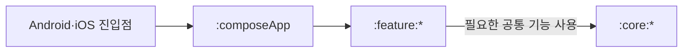
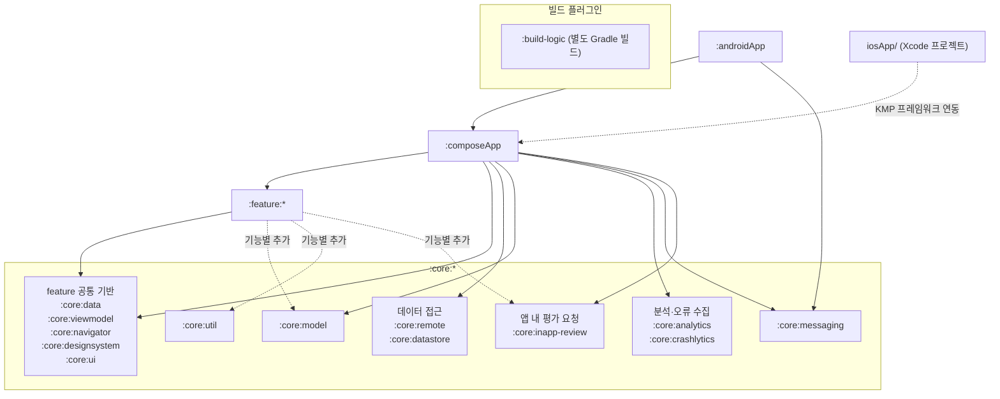
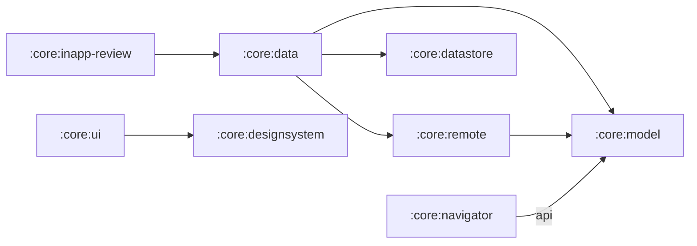
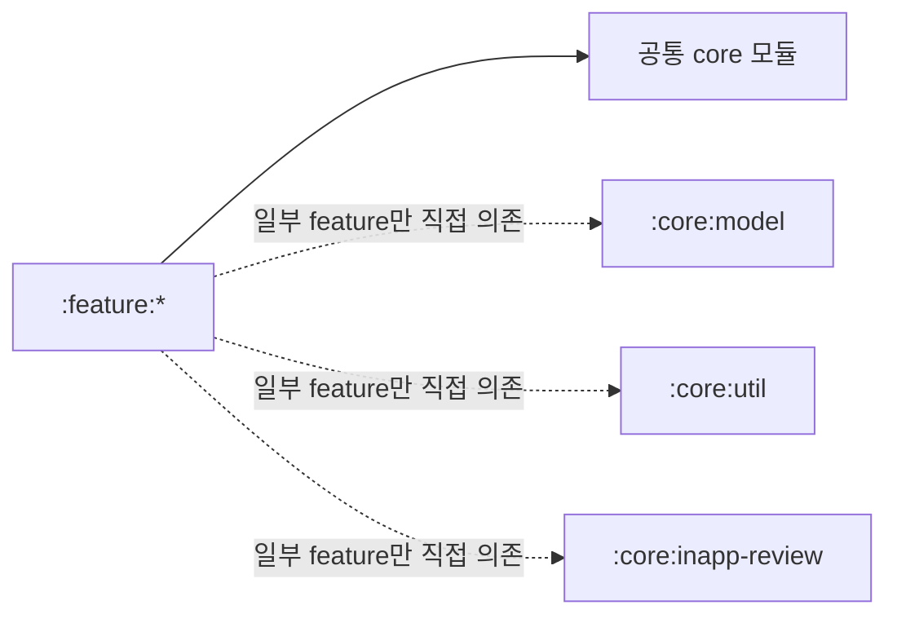
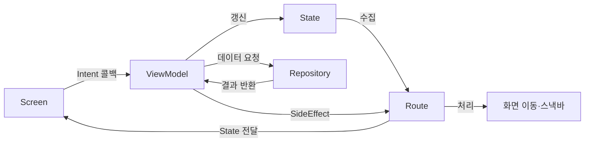
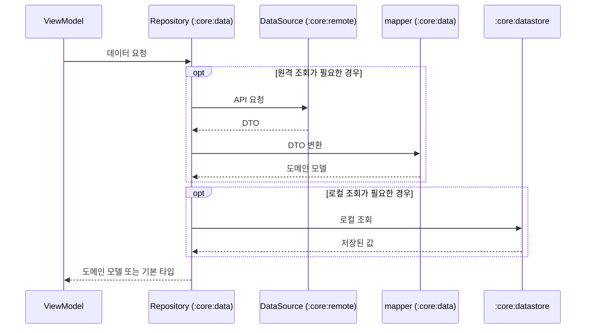
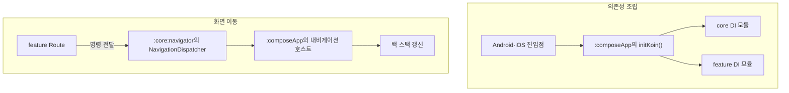
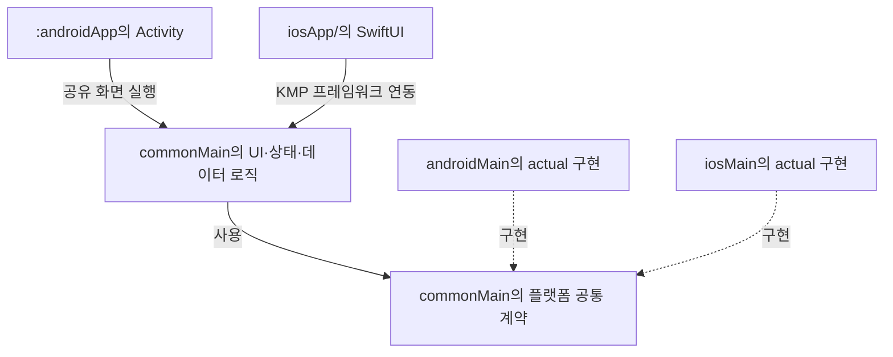
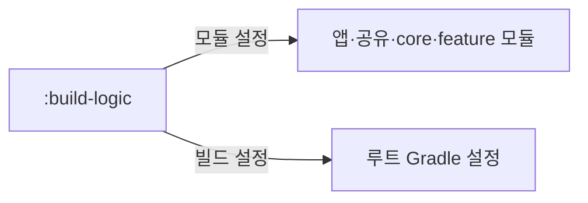
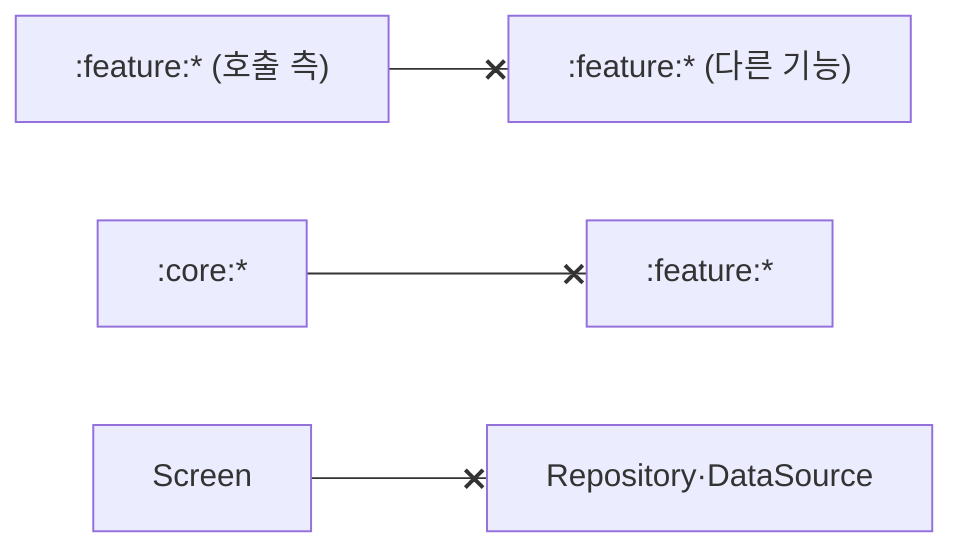

# Caro-Mobile 아키텍처

이 문서는 Caro-Mobile이 유지하는 전체 구조, 계층별 책임과 데이터·상태 흐름을 정의합니다.
코드를 구현·리뷰하거나 모듈 의존성·플랫폼 구성을 변경하기 전에 읽습니다.
구현 규칙·예외·코드 예시는 각 섹션의 상세 문서에서 확인합니다.
공통 작업 절차와 검증은 루트 [AGENTS.md](AGENTS.md)를 따릅니다.

## 1. 아키텍처 개요

Caro-Mobile은 Android·iOS를 지원하는 Kotlin Multiplatform 앱입니다.
Compose Multiplatform으로 화면을 공유합니다. 플랫폼 진입점과 플랫폼별 구현은 분리합니다.

각 feature 모듈은 UI와 상태 처리를 분리합니다. 데이터 접근에는 Repository를 사용합니다.
화면은 MVI의 단방향 상태 흐름을 따릅니다.
여러 feature에서 사용하는 모델·UI·서비스는 core 모듈에서 관리합니다.

아래 화살표는 플랫폼 진입점에서 공유 앱·기능·공통 모듈로 이어지는 구성 흐름을 나타냅니다.

## 2. 전체 구조

아래 그림은 feature 모듈을 `:feature:*` 하나로 표시합니다. core 모듈은 역할별로 묶어 표시합니다.
실선은 직접 의존성을 나타냅니다. 묶음에 연결된 실선은 해당 묶음의 모든 모듈에 적용합니다.
점선은 기능별 추가 의존성과 iOS 프레임워크 연동을 나타냅니다.
core 내부 의존성은 [2.1 core 내부 모듈 관계](#21-core-내부-모듈-관계)를 확인합니다.
기능별 의존성 목록은 [모듈 의존 관계](docs/architecture/modules-platform.md#모듈-의존-관계)를 확인합니다.

`iosApp/`은 Xcode 프로젝트입니다.
이 문서의 `:build-logic`은 `build-logic/`에서 공유 빌드 설정을 제공하는 별도 Gradle 빌드를 가리킵니다.

모든 feature는 공통 기반에 의존합니다.
`:core:model`·`:core:util`로 향하는 점선은 일부 feature가 직접 선언한 의존성입니다.
빌드 플러그인은 별도 영역으로 표시하며, 적용 대상은 [빌드 로직 구성](#7-빌드-로직-구성)에서 확인합니다.

| 구성 | 책임 |
| --- | --- |
| `:androidApp` | Android 생명주기·네이티브 초기화와 공유 화면 실행 |
| `iosApp/` | iOS 생명주기·네이티브 초기화와 공유 화면 실행 |
| `:composeApp` | 공유 앱 UI, 내비게이션 호스트와 DI 모듈 조립 |
| `:feature:*` | 기능별 Route·Screen·ViewModel과 상태·사용자 동작·부수효과 정의 |
| `:core:data` | Repository 계약·구현과 DTO 매핑, 원격·로컬 데이터 접근 조율 |
| `:core:remote` | API 통신·DTO |
| `:core:datastore` | 로컬 저장 구현 |
| `:core:model` | 여러 계층에서 사용하는 도메인 모델 |
| `:core:designsystem` | 테마·리소스·공통 컴포넌트 |
| `:core:ui` | 공유 UI 유틸리티 |
| `:core:viewmodel` | MVI 기반 클래스 |
| `:core:navigator` | 화면 이동 계약·명령 |
| `:core:analytics` | 분석 이벤트 수집 |
| `:core:crashlytics` | 오류·크래시 수집 |
| `:core:messaging` | 푸시 알림 |
| `:core:util` | 숫자 포맷 등의 공통 유틸리티 |
| `:core:inapp-review` | 플랫폼 평가 요청과 앱 전체의 재요청 간격 관리 |
| `:build-logic` | 공유 Gradle 플러그인과 빌드 설정 제공 |

`:composeApp`은 feature와 앱 구성에 필요한 core 모듈을 조립합니다.
분석·오류 수집·푸시 서비스도 앱 구성과 플랫폼 초기화 과정에서 연결합니다.
모듈별 역할과 패키지 구성은 [모듈 구조](docs/architecture/modules-platform.md#모듈-구조)를 확인합니다.
빌드 로직의 내부 구성은 [7. 빌드 로직 구성](#7-빌드-로직-구성)을 확인합니다.

### 2.1 core 내부 모듈 관계

아래 화살표는 모듈에서 다른 core 모듈로 향하는 직접 의존성을 나타냅니다.

데이터 계층은 `:core:model`의 타입을 공유합니다.
`:core:data`는 원격·로컬 데이터 접근과 변환을 조율합니다.

`:core:ui`는 디자인시스템을 사용하는 공유 UI 기능을 제공합니다.
`:core:inapp-review`는 평가 요청 예약을 `:core:data`의 Repository에 위임하고 플랫폼 평가 API를 호출합니다.
`:core:navigator`는 화면 이동에 필요한 모델을 사용합니다. 이 모델은 `api` 의존성으로 호출 모듈에도 노출합니다.

`:core:viewmodel`·`:core:util`과 분석·오류 수집·푸시 모듈은 현재 다른 프로젝트 모듈에 직접 의존하지 않습니다.
전체 목록과 선언 방식은 [core 내부 의존 관계](docs/architecture/modules-platform.md#core-내부-의존-관계)를 확인합니다.

### 2.2 feature와 core 관계

모든 feature에는 `caro.feature` 플러그인이 다음 5개 core 의존성을 공통으로 추가합니다.

실선은 모든 feature가 공통으로 갖는 의존성입니다. 점선은 일부 feature가 직접 선언한 추가 의존성입니다.

| 공통 의존 모듈 | feature에서 사용하는 책임 |
| --- | --- |
| `:core:data` | ViewModel의 Repository 호출 |
| `:core:viewmodel` | ViewModel의 MVI 상태·Intent·SideEffect 처리 기반 |
| `:core:navigator` | Route의 화면 이동 키·명령 전달 |
| `:core:designsystem` | Screen·컴포넌트의 테마·리소스·공통 UI |
| `:core:ui` | Route·Screen에서 사용하는 스낵바·이미지 등의 공유 UI 기능 |

기능에 따라 `:core:model`·`:core:util`·`:core:inapp-review` 같은 모듈을 추가로 선언합니다.
feature의 데이터 요청은 `:core:data`의 Repository를 통해 원격·로컬 구현으로 이어집니다.
feature 간 화면 연결은 `:core:navigator`의 계약을 사용합니다.
core는 feature 구현에 의존하지 않습니다.
각 feature의 연결과 DI 조립은 `:composeApp`에서 수행합니다.

공통 의존성의 설정 원본과 기능별 추가 목록은 [feature와 core 의존 관계](docs/architecture/modules-platform.md#feature와-core-의존-관계)를 확인합니다.

## 3. MVI와 UI

화면은 `BaseViewModel<State, Intent, SideEffect>`를 중심으로 구성합니다.

1. Screen은 전달받은 상태를 표시합니다. 사용자 동작은 Intent 콜백으로 전달합니다.
2. ViewModel은 Intent를 처리합니다. 필요한 Repository 호출 결과를 State에 반영합니다.
3. Route는 State를 수집해 Screen에 전달합니다. Screen은 변경된 상태를 표시합니다.
4. 화면 이동·스낵바 같은 일회성 동작은 SideEffect로 전달합니다. Route는 이 SideEffect를 해당 동작의 처리에 연결합니다.

아래 화살표는 Intent·State·SideEffect의 전달 흐름을 나타냅니다.
상태 변경은 Screen 표시로 이어지고, 일회성 동작은 Route에서 처리합니다.

단순 데이터 요청은 ViewModel에서 Repository를 직접 호출할 수 있습니다.
재사용할 비즈니스 규칙·여러 Repository의 조율·의미 있는 데이터 변환이 필요할 때 UseCase를 도입합니다.

파일 구성과 구현 기준은 [MVI와 UseCase](docs/architecture/feature-ui.md#mvi와-ui-작성)를 확인합니다.
리소스·재사용 범위는 [UI 문자열](docs/architecture/feature-ui.md#ui-문자열)과 [상수·컴포넌트 배치](docs/architecture/feature-ui.md#상수와-컴포넌트-배치)를 확인합니다.

## 4. 데이터 계층

Repository는 원격·로컬 데이터 접근을 조율합니다. 호출자에게는 도메인 모델이나 기본 타입을 제공합니다.
Repository의 인터페이스와 구현은 `:core:data`에서 관리합니다.

- `:core:remote`의 DataSource는 API를 호출하고 DTO를 반환합니다.
- `:core:datastore`는 인증 정보·설정 등의 로컬 저장을 담당합니다.
- `:core:data`의 mapper는 DTO를 `:core:model`의 도메인 모델로 변환합니다.

데이터를 조회할 때는 ViewModel의 Repository 호출이 DataSource로 이어집니다.
mapper는 원격 DTO 응답을 도메인 모델로 변환합니다.
ViewModel은 변환한 결과를 화면 상태에 반영합니다.

아래 그림은 원격·로컬 조회의 호출과 반환 경로를 보여주는 예시입니다.
Repository는 필요한 조회를 조율하고, 원격 DTO 변환은 mapper에 맡깁니다.

구현체 이름은 [DataSource 구현체 이름](docs/architecture/data-layer.md#datasource-구현체-이름)을 확인합니다.
변환 책임·파일 배치·테스트는 [DTO와 도메인 모델 매핑](docs/architecture/data-layer.md#dto와-도메인-모델-매핑)을 확인합니다.

## 5. 앱 조립과 내비게이션

앱 구성은 `:composeApp`에서 조립합니다.
플랫폼 진입점은 공유 `initKoin()`을 호출합니다.
Koin Kotlin 컴파일러 플러그인 기반의 DI 모듈은 공통 서비스와 feature의 의존성을 연결합니다.

화면 이동에는 Navigation3를 사용합니다.
`:core:navigator`는 직렬화 가능한 NavKey와 내비게이션 명령을 정의합니다.
feature의 Route는 `NavigationDispatcher`로 명령을 전달합니다.
`:composeApp`의 내비게이션 호스트는 명령을 받으면 백 스택을 갱신합니다.

‘의존성 조립’ 영역은 DI 모듈을 조립하는 흐름입니다. ‘화면 이동’ 영역은 화면 이동 명령을 처리하는 흐름입니다.

화면 등록·파라미터 전달은 [Navigation3 내비게이션](docs/architecture/navigation.md#navigation3-내비게이션)을 확인합니다.
바인딩·생성자 인자·모듈 연결은 [Koin 의존성 주입](docs/architecture/dependency-injection.md#koin-의존성-주입)을 확인합니다.

## 6. 플랫폼 분리

공유 UI·상태 처리·데이터 로직은 `commonMain`에 둡니다.
플랫폼 기능은 expect/actual과 플랫폼별 소스셋으로 분리합니다.
Android는 Activity에서 공유 화면을 실행합니다.
iOS는 SwiftUI 진입점에서 KMP 프레임워크의 공유 화면을 표시합니다.

실선은 공유 화면 실행과 공통 계약 사용을 나타냅니다. 점선은 플랫폼별 구현과 공통 계약의 관계를 나타냅니다.

플랫폼별 초기화는 [플랫폼 진입점](docs/architecture/modules-platform.md#플랫폼-진입점)을 확인합니다.
구현 분리와 파일명은 [플랫폼 코드](docs/architecture/modules-platform.md#플랫폼-코드)를 확인합니다.

## 7. 빌드 로직 구성

공통 모듈 설정은 `:build-logic`의 Gradle 플러그인으로 통일합니다.

아래 화살표는 `:build-logic`이 플러그인을 제공하는 대상을 나타냅니다.

내부 구조·모듈별 책임·등록 위치와 설정 방식은 [빌드 로직 상세 구성](docs/architecture/convention-plugins.md#빌드-로직-구성)을 확인합니다.
환경 준비와 플랫폼별 빌드는 [개발 환경과 빌드](docs/development/build.md)를 따릅니다.

## 8. 금지사항

아래 그림은 대표적인 금지 경로를 나타냅니다. 끝에 ×가 있는 선은 허용하지 않는 의존성이나 호출입니다.

- feature 모듈끼리 직접 의존하지 않습니다. 다른 feature의 Route·ViewModel을 참조하지 않습니다. 화면 간 연결은 `:core:navigator`를 경유합니다.
- core 모듈에서 feature 구현을 참조하지 않습니다. 앱과 feature의 연결은 `:composeApp`에서 조립합니다.
- Screen에서 Repository·DataSource를 직접 호출하지 않습니다. 데이터 요청과 MVI 상태 변경은 ViewModel에서 처리합니다.
- UI에 원격 DTO를 노출하지 않습니다. DataSource에서 DTO를 도메인 모델로 변환하지 않습니다. 변환은 `:core:data`의 mapper에서 수행합니다.
- 단일 Repository 호출을 감싸기 위한 UseCase는 추가하지 않습니다. 도입 기준은 [MVI와 UseCase 지침](docs/architecture/feature-ui.md#mvi와-ui-작성)을 따릅니다.
- 플랫폼 전용 SDK와 구현을 `commonMain`에 직접 두지 않습니다. 플랫폼별 소스셋과 공통 계약으로 분리합니다.

## 9. 문서 유지보수

변경이 영향을 주는 원본 문서를 갱신한 뒤, 관련 지침과 참조를 확인합니다.
아래 화살표는 문서 갱신과 검증 순서를 나타냅니다.

- 아키텍처 원칙을 바꾸면 이 문서와 해당 상세 문서를 함께 갱신합니다.
- 스킬의 컨벤션 요약과 리뷰 체크리스트는 아키텍처 원본의 원칙·예외에 맞춥니다.
- 문서 갱신·이동·검증은 [문서 관리 지침](docs/AGENTS.md)을 따릅니다. 빌드·프레임워크·서명 설정 변경은 [빌드 문서](docs/development/build.md)에도 반영합니다.
