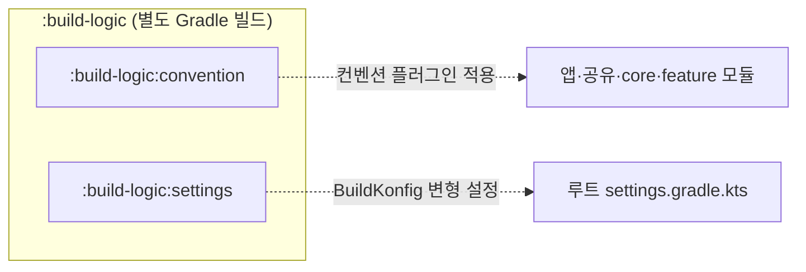

# Gradle 컨벤션 플러그인

[전체 아키텍처](../../ARCHITECTURE.md)의 상세 지침입니다.
이 문서의 주제에 해당하는 코드를 구현·변경·리뷰하기 전에 읽습니다.
공통 작업 규칙은 루트 [AGENTS.md](../../AGENTS.md)를 따릅니다. 빌드·테스트 지침은 [문서 탐색 목록](../index.md)에서 선택합니다.

## 빌드 로직 구성

`:build-logic`은 `build-logic/`의 별도 Gradle 빌드를 가리킵니다.
루트 [settings.gradle.kts](../../settings.gradle.kts)의 `pluginManagement.includeBuild("build-logic")`로 연결합니다.
[빌드 로직의 settings.gradle.kts](../../build-logic/settings.gradle.kts)에서 하위 모듈을 `:convention`과 `:settings`로 등록합니다.
이 문서에서는 두 모듈을 `:build-logic:convention`과 `:build-logic:settings`로 구분합니다.



### :build-logic:convention

앱·공유·core·feature 모듈에 적용할 컨벤션 플러그인을 제공합니다.
KMP 타깃·Compose·DI·테스트 등의 공통 설정을 통일합니다.
[convention/build.gradle.kts](../../build-logic/convention/build.gradle.kts)에서 플러그인 ID와 구현 클래스를 등록합니다.
플러그인 목록과 새 모듈 템플릿은 [컨벤션 플러그인 목록](#컨벤션-플러그인-목록)을 확인합니다.

### :build-logic:settings

루트 Gradle 설정에 적용할 `caro.build.konfig.setting` 플러그인을 제공합니다.
[settings/build.gradle.kts](../../build-logic/settings/build.gradle.kts)에서 등록합니다.
이 플러그인은 BuildKonfig의 환경과 빌드 타입을 설정합니다.

[BuildKonfigSettingPlugin](../../build-logic/settings/src/main/kotlin/BuildKonfigSettingPlugin.kt)은 `-Pbuildkonfig.flavor`를 우선 사용합니다.
값이 없으면 플러그인이 태스크 이름에서 환경·빌드 타입을 추론합니다. 이 값을 프로젝트에 전달합니다.

## 컨벤션 플러그인 목록

| 플러그인 ID | 역할 |
|---|---|
| `caro.kmp` | KMP 기본 설정(코루틴, Napier 로깅, `-Xexpect-actual-classes`) |
| `caro.kmp.android` | Android KMP 타깃 설정(compileSdk 36, minSdk 28, JVM 17) |
| `caro.kmp.ios` | iOS 타깃 설정(x64, arm64, simulatorArm64) |
| `caro.cmp` | Compose Multiplatform 의존성(material3, resources, foundation)과 컴파일러 설정 |
| `caro.feature` | feature 모듈에 core 의존성(designsystem, data, ui, viewmodel, navigator)을 자동 추가. koin-compose-viewmodel도 추가 |
| `caro.koin` | Koin Kotlin 컴파일러 플러그인(`io.insert-koin.compiler.plugin`) 적용. commonMain에 `koin-core` 추가. 단축 DSL(`single<X>()`, `viewModel<X>()`) 사용 지원 |
| `caro.kmp.test` | 테스트 의존성(Kotest, Mokkery, Turbine, coroutines-test, koin-test), Android `withHostTest`·resources 포함·JUnit 호스트 실행 설정 |
| `caro.screenshot` | Roborazzi와 플랫폼별 테스트 의존성 연결. [스크린샷 규칙](../development/screenshot-testing.md) 참고 |
| `caro.kover` | `:core:data`와 `:feature:*`에 Kover 적용. 라인 커버리지 최소 50% 검사 |
| `caro.kotlin.serialization` | kotlinx.serialization 플러그인과 JSON 의존성 추가 |
| `caro.android.application` | Android 애플리케이션 설정 |

**새 feature 모듈의 `build.gradle.kts` 템플릿:**

```kotlin
plugins {
    id("caro.kmp")
    id("caro.kmp.ios")
    id("caro.kmp.android")
    id("caro.cmp")
    id("caro.feature")
    id("caro.koin")
    id("caro.kmp.test")
    id("caro.kover")
}
```
