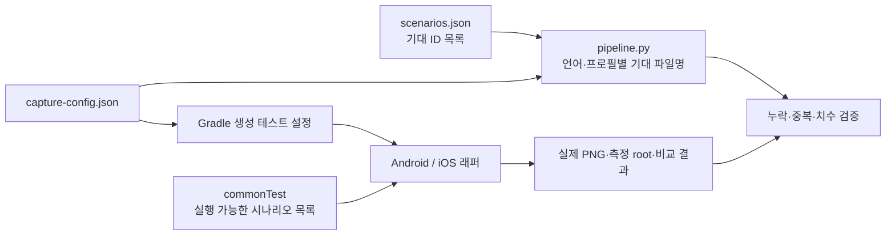
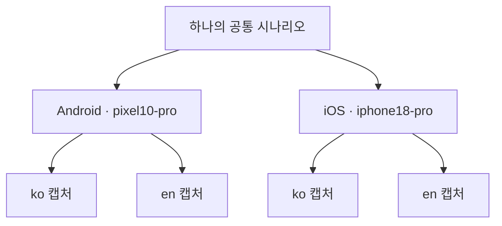

# 스크린샷 테스트 개발

공유 Compose UI의 시각적 회귀를 확인할 때 사용합니다. 시나리오를 추가·수정·삭제하고 Android/iOS에서 한국어·영어
캡처를 생성하는 방법을 설명합니다. CI 실행·Golden·게시 승인과 운영은 [스크린샷 CI](../ci/screenshot-test.md)가 원본입니다.
상태·이벤트·콜백 검증은 [테스트 안내](testing.md)와 함께 선택합니다.

## 소스셋과 기대 목록

| 위치 | 책임 |
| --- | --- |
| `feature/<module>/src/commonTest/kotlin/**/*ScreenshotScenario.kt` | 고정 상태·데이터·논리 ID·렌더러·공유 동작 단언 |
| `src/androidHostTest/kotlin/**/*ScreenshotAndroidTest.kt` | Robolectric + JUnit4 래퍼, 공통 목록을 언어별 실행 |
| `src/iosSimulatorArm64Test/kotlin/**/*ScreenshotIosTest.kt` | Skiko + Kotlin Test 래퍼, 같은 목록을 언어별 실행 |
| `test-support/screenshot/` | 공통 캡처 모델·가상 캔버스, 플랫폼별 로케일 복원·캡처 API·회귀 테스트 |
| `scripts/screenshot/scenarios.json` | 모듈별로 **기대하는 ID 목록** |
| `scripts/screenshot/capture-config.json` | 언어·플랫폼별 프로필·variant·캡처 bounds의 단일 원본 |
| `scripts/screenshot/pipeline.py` | 기대 파일명 확장·PNG·Golden·비교 결과·게시 파일 검증 |

`caro.screenshot`은 지원 코드와 생성한 설정 상수를 테스트 소스셋에만 연결합니다.
`commonMain`이나 다른 feature에 테스트 의존성을 추가하지 않습니다. `caro.kmp.test`가 Android `withHostTest` 설정을 담당합니다.



JSON을 수정해도 테스트가 생성되거나 실행되지는 않습니다. 공통 Kotlin 시나리오, 양쪽 래퍼, 기대 ID를 함께 유지합니다.

## Home 예시

실제 화면은 `HomeScreen(state: HomeState, onIntent: (HomeIntent) -> Unit)`입니다.
`HomeState`의 생성자 필드는 `nickname`, `streakState`, `decks: ImmutableList<Deck>`, `isLoading`, `hasLoadError`이고,
`isLoadedContentVisible`과 `isDeckEmpty`는 파생 값입니다. `isLoading`의 기본값은 `true`이므로 콘텐츠 캡처에서는 `false`를 지정합니다.
`Deck` 생성자는 `id: Long`, `title`, `description`, `cardTotalCount`, `todayLearningCount`, `todayCompleteCount`, `state: DeckState`를 받습니다.

기대 목록:

```json
{
  "home": ["home.home.with_deck"]
}
```

`feature/home/src/commonTest/kotlin/com/whatever/caro/feature/home/HomeScreenshotScenario.kt`의 핵심 구조:

```kotlin
internal object HomeScreenshotScenario {
    const val ID = "home.home.with_deck"

    fun scenarios() = listOf(
        ScreenshotScenario(
            ID,
            render = { Render() },
            beforeCapture = { language ->
                onNodeWithText(if (language == "ko") "덱 만들기" else "Create Deck").assertIsDisplayed()
            },
        ),
    )

    @Composable
    fun Render() {
        CaroTheme {
            HomeScreen(
                state = HomeState(
                    nickname = "승우",
                    streakState = HomeStreakState.NotStarted,
                    decks = persistentListOf(
                        Deck(1, "Android", "기초 학습", 10, 5, 0, DeckState.NOT_STARTED),
                    ),
                    isLoading = false,
                ),
                onIntent = {},
            )
        }
    }
}
```

플랫폼 래퍼는 이 객체의 `scenarios` 팩토리를 전달합니다. 각 캡처에 새 객체를 만들어 콜백 횟수가 다음 언어에 누적되지 않게 합니다.
Android는 `ParameterizedRobolectricTestRunner`의 파라미터마다 새 Compose rule을 사용합니다. 한 rule에서 `setContent`를 반복하지 않습니다.

```kotlin
// Android 래퍼: createAndroidComposeRule<ComponentActivity>()
@Test
fun capture() = captureAndroidScreenshot(composeRule, capture)

companion object {
    @JvmStatic
    @ParameterizedRobolectricTestRunner.Parameters(name = "{0}")
    fun captures(): List<Array<Any>> =
        screenshotCaptures("android", HomeScreenshotScenario::scenarios).map { arrayOf(it) }
}
```

```kotlin
// iOS 래퍼: 동일한 공통 목록
@Test
fun captures() = captureIosScreenshots(HomeScreenshotScenario::scenarios)
```

캡처 API는 다릅니다. 공통 시나리오 안에 플랫폼 캡처 import를 넣지 않습니다.

```kotlin
// androidHostTest 도우미
import com.github.takahirom.roborazzi.captureRoboImage
rule.onRoot().captureRoboImage(capture.fileName)

// iosSimulatorArm64Test 도우미: runSkikoComposeUiTest의 receiver
import io.github.takahirom.roborazzi.captureRoboImage
onRoot().captureRoboImage(this, filePath = capture.fileName)
```

## 언어와 파일명



파일명은 `<scenario-id>__<language>__<profile-id>.png`입니다. 플랫폼은 출력 경로와 메타데이터에 둡니다.
예: `home.home.with_deck__ko__pixel10-pro.png`, `home.home.with_deck__en__iphone18-pro.png`.
논리 ID에 언어·프로필을 붙이거나 ko/en Screen 복사본을 만들지 않습니다.

도우미는 Android의 기본 Locale·LocaleList·Robolectric qualifiers와 iOS의 `AppleLanguages`를 `finally`에서 복원합니다.
Compose resources가 실제 로케일을 읽게 설정한 뒤 콘텐츠를 구성합니다. Home의 `덱 만들기`/`Create Deck`, Setting의
`설정`/`Settings` 의미 단언으로 리소스 전환을 확인합니다. 파일명만 바뀌고 화면 언어가 같으면 실패해야 합니다.
사용자가 입력한 값인 고정 닉네임·덱 이름·학습 단어는 번역할 필요가 없습니다.

## 가상 캔버스와 측정

| 기본 프로필 | 가상 크기 px | 논리 밀도 | 논리 크기 | fontScale |
| --- | --- | --- | --- | --- |
| `pixel10-pro` | 1280 × 2856 | 3 | 426.666… × 952 dp | 1 |
| `iphone18-pro` | 1206 × 2622 | 3 | 402 × 874 pt | 1 |

[Pixel 공식 사양](https://store.google.com/product/pixel_10_pro_specs?hl=en-US)의 495 ppi는 물리 픽셀 밀도입니다.
Android Studio 기기 정의와 AVD의 480 dpi/xxhdpi를 논리 밀도 3으로 사용합니다. 495를 Compose density에 넣지 않습니다.
[Apple 공식 사양](https://support.apple.com/ko-kr/148590)의 픽셀 크기와 Simulator 기기 정의의 scale 3을 iOS 프로필에 사용합니다.
전체 직사각형의 기하 크기이며 실제 기기의 safe area·시스템 바를 뺀 앱 영역을 측정한 값은 아닙니다.

[Compose ui-test 1.11.0 소스](https://repo.maven.apache.org/maven2/org/jetbrains/compose/ui/ui-test/1.11.0/ui-test-1.11.0-sources.jar)의
`runSkikoComposeUiTest(size, density)`에서 `size`는 **px**이고 기본 density는 1입니다. iOS 도우미는 두 인수를 모두 지정합니다.
Android는 가상 window의 px 크기를 지정하고, 공통 캔버스는 같은 density/fontScale과 필요한 논리 크기를 제공합니다.
393 같은 dp 숫자를 density 1의 px 인수로 넘겨 네이티브 기기 크기라고 표현하지 않습니다.

일반 화면은 Compose `onRoot()`를, 권한 다이얼로그는 `isDialog()` 의미 노드를 선택합니다. 시스템 바를 포함하는 전체 기기 캡처가 아닙니다.
일반 root는 설정된 캔버스와 정확히 일치해야 합니다. Android 다이얼로그는 선택한 노드의 Compose 소유 View가
같은 크기이고 window에 연결되어 있는지 확인한 뒤 Roborazzi의 View 캡처 API를 사용합니다.
이는 여러 window를 합치는 Roborazzi의 semantics 캡처 경로와 Compose `captureToImage`의 frame-commit 대기를 피합니다.
권한 다이얼로그는 콘텐츠 크기를 캡처하므로
`contentSizedScenarios`에 명시하며, 측정값이 캔버스 안에 있는지 검사합니다. 테스트 로그의 `SCREENSHOT_GEOMETRY`에는
root px·density·fontScale을 기록하고, CI 메타데이터에는 검증한 `pngSize`를 보관합니다. 불일치를 반올림으로 숨기지 않습니다.

`setting.notification.small.large-font` 하나는 `small-large-font` variant를 사용합니다.
양쪽 플랫폼 모두 320 × 480 논리 캔버스, fontScale 1.5이며 `계정탈퇴`/`Delete Account`까지 스크롤한 뒤 캡처합니다.
다른 모든 시나리오를 이 variant로 다시 곱하지 않습니다.

캡처 프로필 이름과 테스트를 호스팅하는 Simulator/SDK는 별개입니다. 실제 iPhone 18 Pro Simulator는 iOS 27 런타임이 필요하지만,
가상 콘텐츠의 크기를 적용하기 위해 CI의 Xcode 26.6을 올리지 않습니다. 프로필 이름만으로 실제 기기 실행을 주장하지 않습니다.

## 결정적인 상태와 동작

- 데이터·시간·날짜·타임존·난수는 고정합니다. 네트워크와 원격 이미지를 사용하지 않고 필요한 fake를 주입합니다.
- production ViewModel·Koin 그래프 없이 Screen에 상태·콜백을 전달합니다. feature 간 테스트 의존성도 추가하지 않습니다.
- 도우미는 자동 애니메이션 진행을 멈추고 고정된 시점까지 진행합니다. 새 비동기 로더나 애니메이션은 완료·정지 조건도 정의합니다.
- 상태별 캡처에 필요한 UI 동작 단언을 유지합니다. 설정 시나리오는 토글의 켜짐·클릭 1회, 로딩 중 비활성화,
  작은 화면 스크롤 도달, 다이얼로그의 취소·설정 콜백 각각 1회를 양쪽 플랫폼에서 검사합니다.
- 시각 결과만 비교하는 테스트로 로그인·서버 저장·권한 SDK까지 통합 동작했다고 주장하지 않습니다.

## 로컬 실행과 결과

[빌드 환경](build.md)에 맞춰 JDK·Android SDK·Xcode와 로컬 설정을 준비합니다. 개인 `local.properties`를 덮어쓰지 않습니다.
저장소 루트에서 실행합니다. 기록은 로컬 기준 이미지를 생성하고 비교는 그 기준과 현재 UI를 비교합니다.

```bash
./gradlew :feature:home:recordRoborazziAndroidHostTest :feature:home:testAndroidHostTest --rerun
./gradlew :feature:home:recordRoborazziIosSimulatorArm64 :feature:home:iosSimulatorArm64Test --rerun
./gradlew :feature:home:compareRoborazziAndroidHostTest :feature:home:testAndroidHostTest --rerun
./gradlew :feature:home:compareRoborazziIosSimulatorArm64 :feature:home:iosSimulatorArm64Test --rerun
```

전체 대상은 루트 `recordRoborazziAndroidHostTest`, `recordRoborazziIosSimulatorArm64`,
`compareRoborazziAndroidHostTest`, `compareRoborazziIosSimulatorArm64`를 사용합니다.
CI는 registry의 각 feature 테스트 태스크에만 `--rerun`을 붙여 캡처를 재실행합니다. 전역 `--rerun-tasks`로 컴파일 캐시를 무효화하지 않습니다.
iOS 환경과 앱 빌드 명령은 [iOS 빌드 안내](build.md#ios-빌드)를 따릅니다.
CI의 Xcode 선택은 [Golden 워크플로](../../.github/workflows/screenshot-golden.yml)와
[PR 워크플로](../../.github/workflows/screenshot-pr.yml)에서 확인합니다.

| 산출물 | 경로 |
| --- | --- |
| PNG | `feature/<module>/build/outputs/roborazzi/androidHostTest/` 또는 `iosSimulatorArm64/` |
| Roborazzi JSON | `feature/<module>/build/test-results/roborazzi/<target>/results-summary.json` |
| HTML | `feature/<module>/build/reports/roborazzi/<target>/index.html` |
| CI 수집 메타데이터 | `build/screenshot-golden/metadata.json`, `build/screenshot-before-after/summary.json` |

```bash
# 기대 캡처 목록 확인, Python 계약 회귀 테스트
python3 scripts/screenshot/pipeline.py expand --platform android
python3 scripts/screenshot/pipeline.py expand --platform ios
python3 scripts/screenshot/test_pipeline.py
```

PNG·보고서·임시 작업 기록은 빌드 산출물이며 커밋하지 않습니다. 기준을 기록한 직후 비교가 통과한 것은 시각적 승인이 아닙니다.
기존 기준과 변경된 화면의 원본을 열어 차이를 확인합니다.

## 실패 사례와 확인 목록

| 실패 사례 | 확인할 대상 |
| --- | --- |
| Kotlin 캡처만 추가해 `Registry/output mismatch` 발생 | `scenarios.json`의 ID 등록 |
| JSON만 추가해 `Registry/result mismatch` 발생 | 공통 실행 목록·Android/iOS 래퍼 |
| Android 결과만 있고 iOS 결과 누락 | 같은 시나리오 팩토리를 양쪽 래퍼가 실행하는지 확인 |
| `<ID>.png` 또는 잘못된 언어·프로필 파일명 | 공통 도우미·v2 파일명, 오래된 출력 디렉토리 |
| root/PNG geometry mismatch | px/dp·density·window 크기·다이얼로그 bounds 구분 |
| legacy/incompatible Golden 오류 | [v2 Golden 전환](../ci/screenshot-test.md#v2-golden-전환) |

- [ ] 순수 Screen·고정 상태·데이터와 공통 시나리오 목록을 작성했습니다.
- [ ] 추가·삭제 ID를 registry와 양쪽 플랫폼 실행에 반영했습니다.
- [ ] ko/en 실제 문자열과 고유 파일명, 프로필별 치수를 확인했습니다.
- [ ] 오류가 나도 로케일을 복원하며 불안정한 시간·네트워크·애니메이션을 제거했습니다.
- [ ] 기존 콜백·로딩·스크롤 등 동작 단언을 유지했습니다.
- [ ] 영향 모듈·플랫폼 검사와 원본 시각 검토를 구분해 보고했습니다.
