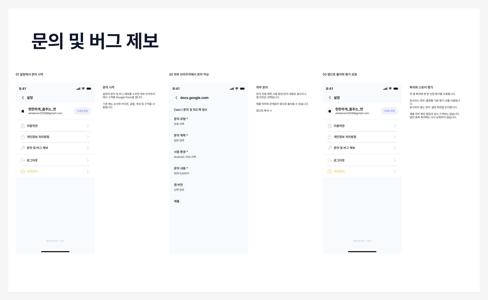

# 문의 및 버그 제보 화면 설계

## 사용자 흐름

홈 → 설정 → 문의 및 버그 제보 → 외부 Google Form → 앱 복귀 → 평가 요청 간격 확인 → 설정 이용 계속.

## 설정 화면

- 상단 제목은 ‘설정’이며 왼쪽 뒤로 가기 동작을 제공한다.
- 프로필에는 로그인 제공자 아이콘, 닉네임, 이메일과 ‘닉네임 변경’을 표시한다.
- 첫 메뉴 묶음은 이용약관, 개인정보 처리방침, ‘문의 및 버그 제보’ 순서다.
- 각 행은 기존 아이콘, 제목, 오른쪽 화살표와 구분선을 재사용한다.
- 둘째 메뉴 묶음은 로그아웃과 계정탈퇴이며, 하단에는 현재 앱 버전을 표시한다.
- 문의 메뉴는 기존 Heading3/Medium 16px, 기본 텍스트 색상, 아이콘 색상과 간격을 사용한다.

## 외부 문의 화면

- 외부 브라우저에서 앱 언어에 따라 한국어 또는 영문 고객용 Google Form을 연다.
- 폼의 필수 항목은 문의 유형, 문의 제목, 사용 환경, 문의 내용이고 앱 버전은 선택이다.
- 폼은 Google Forms가 제공하는 화면과 입력 검증을 사용한다. 앱 안에 별도 문의 입력 화면을 두지 않는다.
- 사용자는 제출 여부와 관계없이 앱으로 돌아올 수 있다.

## 복귀 화면

- 앱으로 돌아오면 설정 화면을 유지한다. 앱 전체의 마지막 평가 요청 시도로부터 30일 이상 지났거나 요청 기록이 없으면 인앱 평가를 요청한다.
- 평가창이 표시되는 경우 각 플랫폼의 기본 UI를 사용한다. 앱이 별도의 별점 입력창을 만들지 않는다.
- 스토어가 평가창을 표시하지 않거나 사용자가 닫아도 설정 이용을 계속한다.
- 감사 스낵바와 제출 여부 확인 팝업을 표시하지 않는다.
- 실제 백그라운드를 거친 최초 복귀만 평가 요청 대상이다.
- 폼 열기 실패·취소나 화면 이동만으로는 평가를 요청하지 않는다.
- 다른 기능에서 평가를 요청해도 같은 30일 기록을 사용한다. 평가창 표시 여부나 실제 평가 완료 여부는 기록하지 않는다.

## 언어별 문의 주소

- 한국어 폼 주소와 기본 언어의 폼 주소를 별도 리소스로 관리한다.
- 한국어는 `values-ko/strings.xml`의 한국어 폼 주소를 사용한다.
- 기본 언어는 `values/strings.xml`에 지정한 영문 폼 ‘Caro | Customer Support & Feedback’을 바로 연다. 질문과 선택지도 영어로 제공한다.

## 화면별 조건

| 화면·상태 | 표시 조건 | 사용자 행동과 결과 |
|---|---|---|
| 설정 | 설정 진입·문의 복귀 | 문의 메뉴를 누르면 외부 폼 열기 |
| 외부 문의 폼 | 폼 열기 성공 | 작성·제출·취소 후 앱 복귀 |
| 설정 + 플랫폼 평가 | 첫 실제 복귀·30일 간격 충족 후 스토어가 UI 표시 | 평가 또는 닫기 후 설정 유지 |
| 설정만 표시 | 30일 간격 미충족·평가 UI 미표시·요청 실패 | 설정 이용 계속 |

## 연결

- [기획 정책](https://app.slack.com/files/U0C5215G1CM/F0CBXE63DBP)
- [개발 설계](inquiry-feedback-design.md)
- [대표 이슈](https://github.com/whatever-x/Caro-Workflow/issues/20)

- [Figma 디자인 정본](https://www.figma.com/design/PVw3ZFpRQf2JL3gv2AVOg9/Caro?node-id=58276-3266)

